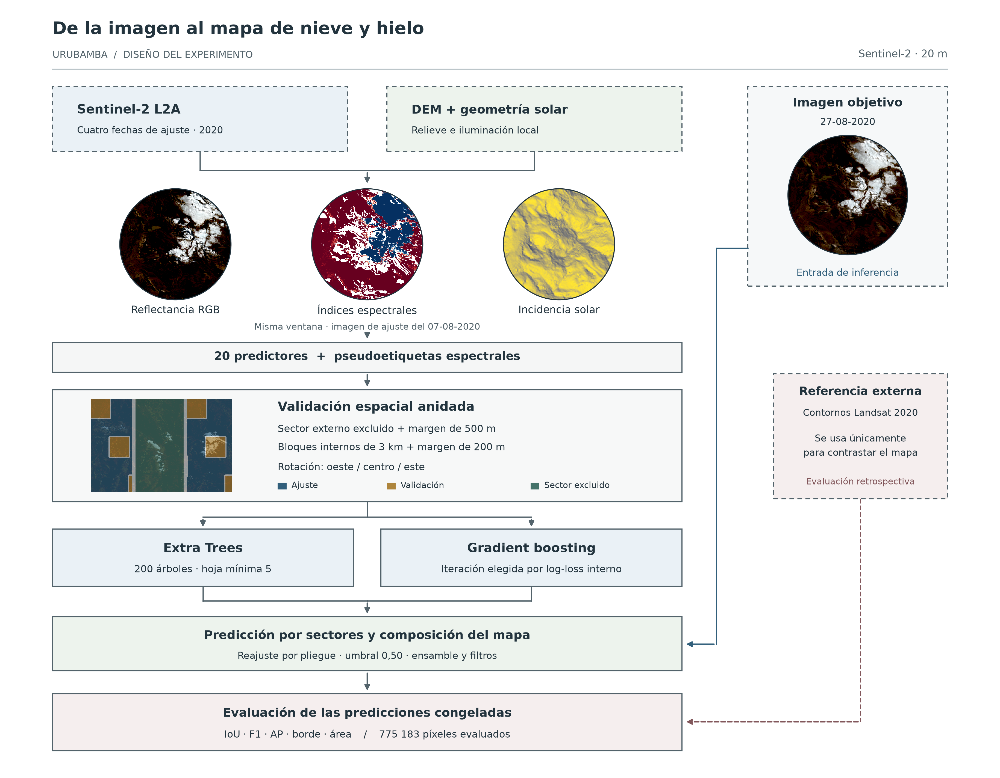

# Snow and visible-ice mapping in the Cordillera Urubamba (Peru) with Sentinel-2

Pixel classifiers for snow and visible ice at 20 m, trained **only on spectral pseudo-labels**
and scored against independent 2020 glacier outlines that are never used for fitting.
The study area is a 22 × 14.5 km box of the Cordillera Urubamba (UTM 18S,
E 808–830 km, N 8530–8544.5 km).

The full write-up, in Spanish, is the notebook
[`notebooks/urubamba_nieve_hielo.ipynb`](notebooks/urubamba_nieve_hielo.ipynb).



## Question

Does a snow/ice map improve in places not used for training when you add terrain and
illumination predictors, make the negative pseudo-labels more cautious, or switch from
Extra Trees to gradient boosting? Every option is scored on the same pixels, with paired
block-bootstrap intervals, so small gains can be told apart from noise.

## Results

Target scene 27 August 2020; 775 183 evaluated pixels of 20 m; 8.08 km² of reference
ice (2.60 % positives). IoU is for the positive class; 95 % intervals from 2 000 paired
resamples of 1 km blocks.

| Method | IoU | 95 % interval | F1 | Boundary F1 (20 m) | P95 boundary distance (m) | Area bias (km²) |
|---|---:|---:|---:|---:|---:|---:|
| NDSI threshold | 0.7865 | 0.698–0.843 | 0.880 | 0.770 | 221 | +0.47 |
| NDSI threshold + clean-up | 0.8002 | 0.710–0.856 | 0.889 | 0.765 | 181 | +0.32 |
| Extra Trees, 13 variables + clean-up | 0.8054 | 0.717–0.860 | 0.892 | 0.776 | 146 | +0.45 |
| Extra Trees, 20 variables + clean-up | 0.8048 | 0.716–0.861 | 0.892 | 0.777 | 152 | +0.50 |
| Extra Trees, cautious negatives + clean-up | 0.8078 | 0.718–0.863 | 0.894 | 0.782 | 117 | +0.62 |
| Gradient boosting, cautious negatives + clean-up | **0.8083** | 0.716–0.866 | 0.894 | 0.764 | 120 | +0.70 |
| Ensemble of two Extra Trees + clean-up | 0.8076 | 0.719–0.863 | 0.894 | 0.780 | 141 | +0.52 |
| Extra Trees, 13 variables + edge-preserving filter | 0.7984 | 0.709–0.854 | 0.888 | 0.785 | 179 | +0.42 |
| Extra Trees, cautious negatives + edge-preserving filter | 0.8020 | 0.712–0.859 | 0.890 | **0.788** | 179 | +0.61 |

What the numbers support:

* **Spatial clean-up is the only large, clear gain:** +1.86 IoU points (paired interval
  1.31 to 2.63).
* **Each modelling change is small.** Adding terrain predictors: +0.105 points
  (−0.003 to 0.233). Cautious negatives: +0.202 (−0.075 to 0.453). Boosting instead of
  Extra Trees: +0.486 (−0.043 to 0.993). All three intervals include zero. The two-model
  ensemble gains +0.22 over the 13-variable Extra Trees (0.03 to 0.44): positive but tiny.
* **Boosting ranks pixels better:** average precision 0.915, against 0.884 for Extra Trees
  with 13 variables and 0.832 for raw NDSI. At the fixed 0.50 threshold that advantage
  mostly disappears.
* **No method wins every metric.** The edge-preserving filter gives the best boundary F1
  (0.788 with cautious negatives, 0.785 with the 13-variable model), but on the 13-variable
  model it loses 0.70 IoU points (−1.10 to −0.37). Every learned map overestimates area.

The highlighted method was chosen after looking at the evaluation, and the reference
outlines come from an annual Landsat composite. The comparison is therefore
**exploratory**. It does not validate debris-covered ice, glacier change or any
resolution finer than 20 m.

## Method

1. **Data.** Five Sentinel-2 L2A acquisitions from the 2020 dry season (four for fitting,
   one target), block-averaged to a 20 m grid. Pixels are kept when the scene
   classification is 2, 4, 5, 6 or 11. The DEM is the ALOS PALSAR RTC product
   `AP_27628_PLR_F6920_RT1`.
2. **Predictors.** Base set of 13: six reflectances, NDSI, NDVI, NDWI, elevation, slope
   and the 3 × 3 NDSI mean and standard deviation. The full set of 20 adds aspect, local
   solar incidence from each scene's sun position, DEM roughness, NDGI and 7 × 7 NDSI
   context.
3. **Pseudo-labels.** Positive: NDSI ≥ 0.55, red/SWIR1 ≥ 2 and NIR ≥ 0.15. Base negative:
   NDSI ≤ 0.15 or NIR ≤ 0.08. Cautious negative: NDSI ≤ 0.15 only, so dark (possibly
   shaded) ice is not forced into the background class. Ambiguous pixels are never used.
4. **Spatial separation.** Three sectors (west, centre, east). Each model excludes its
   target sector plus a 500 m margin, and uses up to 3 500 samples per class and date.
   The boosting iteration count is chosen on internal 3 km blocks with a 200 m gap. The
   target scene never contributes labels.
5. **Evaluation.** All settings are written to `results/configuration.json`, and the maps
   are hashed before the reference is read. Metrics: IoU, F1, precision, recall, MCC,
   boundary F1 at 20 and 40 m, boundary distance, area bias, and average precision of the
   continuous scores. Results are also given by sector, illumination, slope and NIR.

## Reproduce

```bash
conda create -n urubamba python=3.12
conda activate urubamba
pip install -r requirements.txt
pip install -e .
python -m urubamba download   # Sentinel-2 crops and reference outlines
python -m urubamba fit        # about 75 s of model fitting on 4 CPU cores
python -m urubamba evaluate
python -m urubamba figures
pytest
```

The DEM needs a free NASA Earthdata account. Download granule `AP_27628_PLR_F6920_RT1`
from the [ASF Data Search](https://search.asf.alaska.edu) and copy
`AP_27628_PLR_F6920_RT1.dem.tif` to `data/dem/`. The scores can vary slightly with other
library versions; the versions used are pinned in `requirements.txt`.

## Repository

```
src/urubamba/   config, grid, data, features, labels, models, postprocess, evaluate, figures
notebooks/      the article (Spanish), executed
results/        tables (CSV), figures (PNG 300 dpi, SVG, caption .txt), configuration
tests/          checks of geometry, label rules, clean-up and metrics
```

Rasters, fitted models and input data are written to `outputs/` and `data/`; they are not
versioned.

## Data sources and licences

* **Sentinel-2:** contains modified Copernicus Sentinel data (2020), accessed through
  [Earth Search](https://earth-search.aws.element84.com/v1).
* **DEM:** ALOS PALSAR RTC high-resolution DEM, ASF DAAC. Includes material © JAXA/METI 2007.
* **Reference outlines:** Taylor, L., Quincey, D., Smith, M., Potter, E., Castro, J. and
  Fyffe, C. (2022). *Glacier boundaries (1975–2020) and elevation change (2000–2020) of
  the Peruvian Cordilleras Vilcanota, Vilcabamba, and Urubamba* (v1.0). NERC EDS UK Polar
  Data Centre. <https://doi.org/10.5285/d4dedc2d-1f7f-45c8-8b04-41b8b099cef9>.
  Contains public sector information licensed under the Open Government Licence v3.0.

The code is released under the MIT licence.
